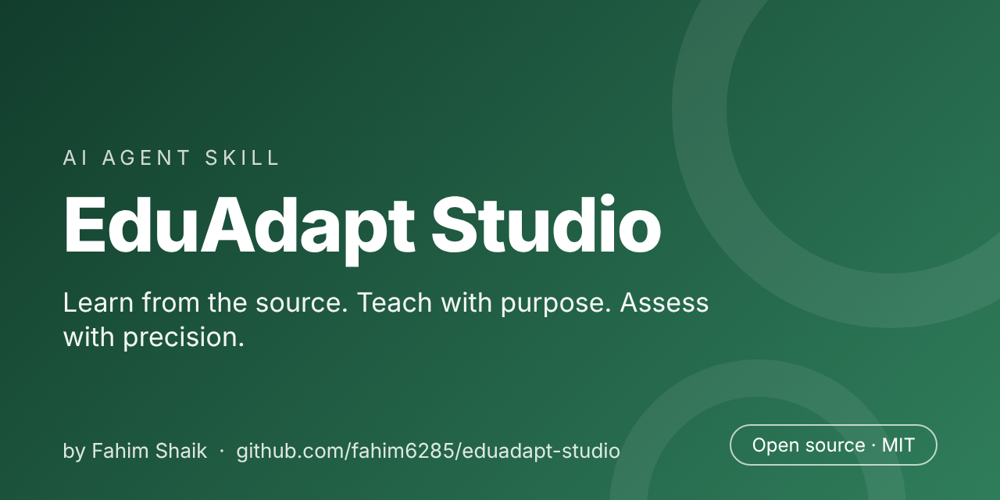

# EduAdapt Studio

**Learn from the source. Teach with purpose. Assess with precision.**

   

Template-neutral AI agent for teaching: turns syllabi into lesson plans, question banks, exam papers, marking keys and rubrics, with blueprint mapping and audit scripts.



## Why use it

- **Syllabus extraction.** Breaks a governing syllabus into units, scope and a time budget before anything is written.
- **Lessons and resources.** Syllabus-aligned lesson plans and instructional materials for any level, subject and country.
- **Assessments.** Question banks, exam papers, marking keys and rubrics built on assessment blueprints.
- **Template fidelity.** Follows your destination template, board rules and mark scheme instead of assuming one.
- **Audit scripts.** Checks a structured assessment or lesson plan for balance, totals and coverage gaps.

## What is in this repository

| Part | Count | Location |
|---|---|---|
| Main skill | 1 | `skills/eduadapt-studio/SKILL.md` |
| Agent setup text | see folder | `skills/eduadapt-studio/AGENT_INSTRUCTIONS.md` |
| Reference protocols | 8 | `skills/eduadapt-studio/references/` |
| Templates | 7 | `skills/eduadapt-studio/templates/` |
| Python utilities | 2 | `skills/eduadapt-studio/scripts/` |
| Synthetic examples | 3 | `skills/eduadapt-studio/examples/` |
| Plugin manifest | 1 | `.codex-plugin/plugin.json` |

All examples are synthetic. The repository contains no private data, research results, credentials or institutional records.

## How to use it

1. **In ChatGPT or another agent builder:** create a skill or plugin from `skills/eduadapt-studio/SKILL.md` and paste `AGENT_INSTRUCTIONS.md` where the platform asks for instructions.
2. **In a regular chat:** attach `SKILL.md` and the reference files, or paste them, then describe your task.
3. **Offline tools:** run the scripts directly (see Quick start).

## Quick start

```bash
cd skills/eduadapt-studio
python -m unittest discover -s tests
python scripts/audit_assessment.py --help
python scripts/audit_plan.py --help
```

The audit scripts check structured files after syllabus and template extraction. A clean report does not certify official examination approval. Scripts run offline using only the Python standard library.

## Sample prompts

- Extract the units and time budget from this syllabus and map them to a lesson plan.
- Create a question paper from this blueprint, with a marking key.
- Adapt this exam template to my course and keep its exact structure.
- Write a rubric for this assignment aligned to the stated learning outcomes.
- Audit my assessment inventory for coverage gaps and mark-total errors.
- Prepare slides and notes for Unit 2, then run a content and format audit.

More prompts are in [`docs/sample-prompts.md`](docs/sample-prompts.md).

## Principles

Evidence first. No invented facts, scores, citations or records. Every claim traces to a source you provided or an official source the agent checks. Third-party documents are treated as content, never as instructions.

## Part of a suite

This agent belongs to [Fahim's AI Agents](https://github.com/fahim6285/fahim-ai-agents), a set of five open-source agents for academic and research work: VitaMorph Studio, SciForge Lab, CareerBridge Academic, RankMetric Intelligence and EduAdapt Studio.

## Contributing, citing and license

Contributions are welcome. See [CONTRIBUTING.md](CONTRIBUTING.md). To cite this work, use the "Cite this repository" button on GitHub (from `CITATION.cff`). Released under the [MIT License](LICENSE).

Created by **Fahim Shaik**.
